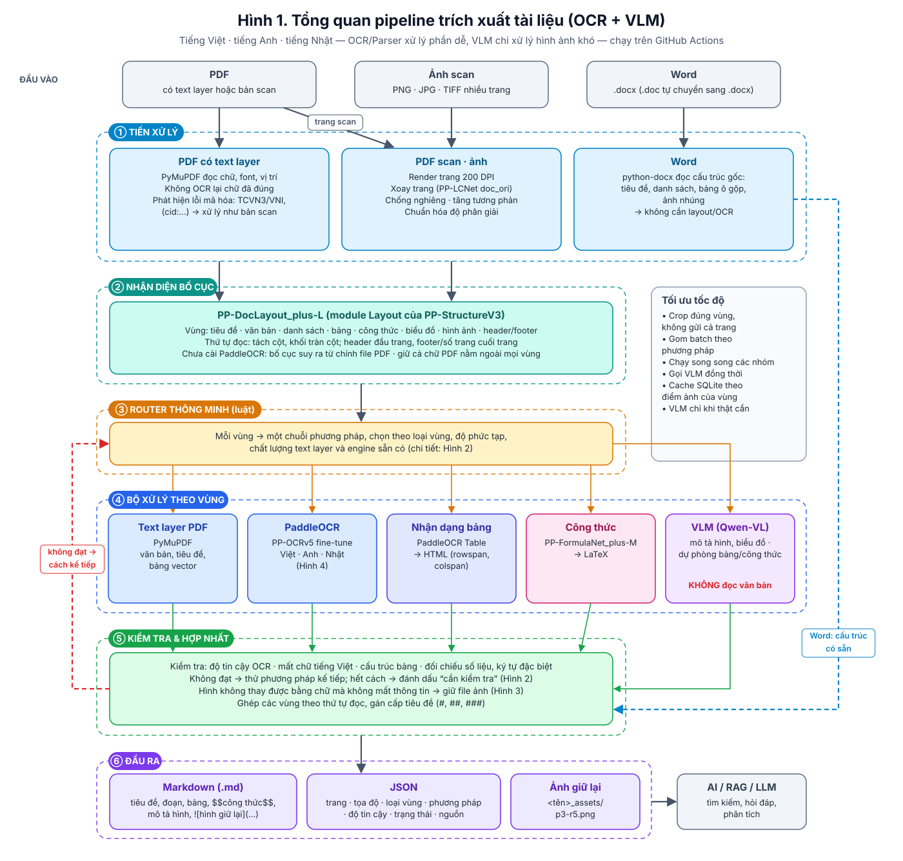
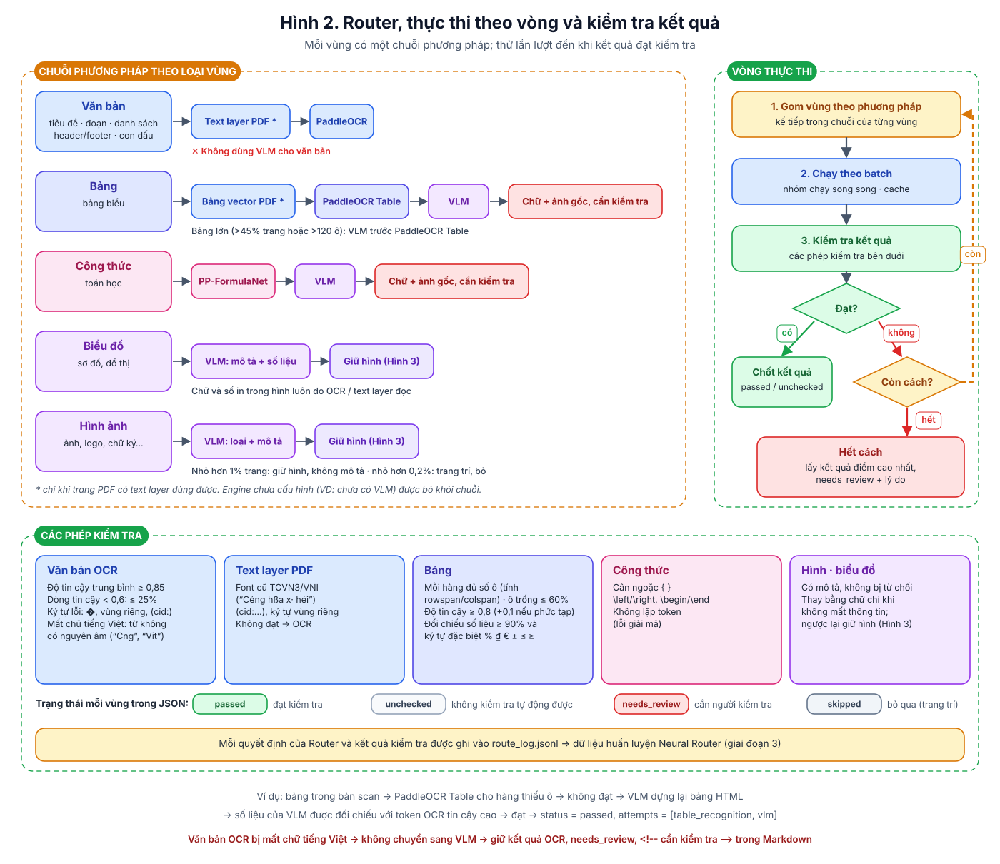
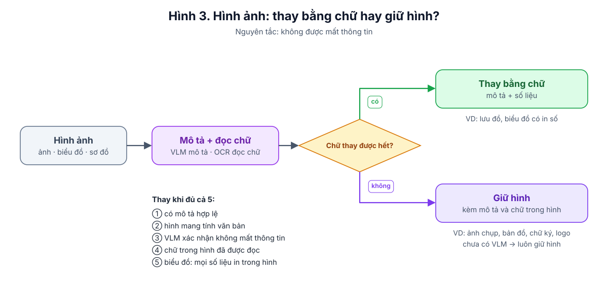
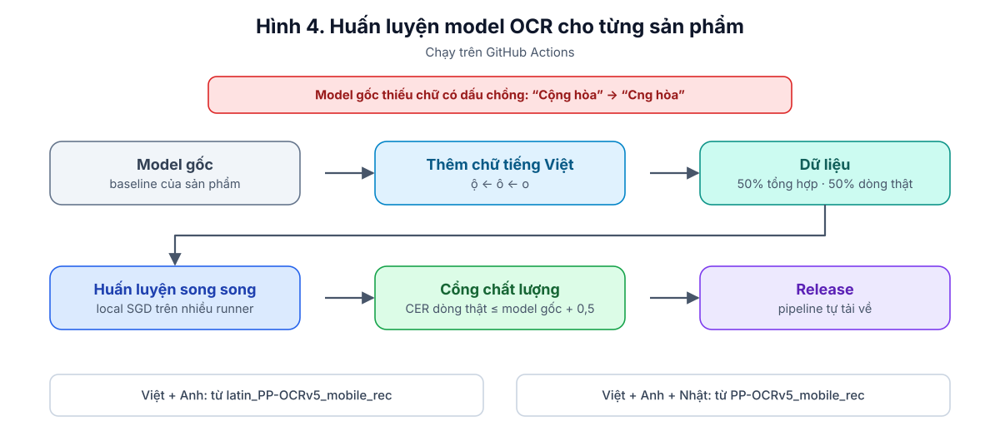

# docextract — Trích xuất tài liệu doanh nghiệp bằng OCR + VLM (Việt + Anh · Việt + Anh + Nhật)

docextract chuyển tài liệu doanh nghiệp thành **Markdown + JSON có cấu trúc**, dùng cho tìm kiếm, hỏi đáp bằng
mô hình ngôn ngữ (RAG / LLM), trích xuất số liệu và lưu trữ số. Loại tài liệu gồm báo cáo tài chính, báo cáo thường
niên, nghị quyết, biên bản, công văn, hợp đồng, hóa đơn. Ngôn ngữ: tiếng Việt, tiếng Anh, tiếng Nhật. Định dạng
vào: PDF số, bản scan, ảnh chụp, Word, Excel, PowerPoint.

- **Văn bản chỉ lấy từ lớp chữ của tài liệu hoặc từ OCR.** VLM không bao giờ viết ra văn bản. VLM chỉ mô tả hình và
  biểu đồ, và là phương án dự phòng cho cấu trúc bảng hoặc công thức.
- **Model nhận dạng chữ được fine-tune cho tiếng Việt.** Model gốc của PaddleOCR thiếu phần lớn chữ Việt có hai dấu.
  Mỗi sản phẩm có một model fine-tune riêng, cùng kiến trúc và cùng tốc độ với model gốc.
- **Mọi bước chạy trên GitHub Actions bằng CPU:** thu thập dữ liệu, huấn luyện, đánh giá, trích xuất, phát hành.
  Không cần GPU, không dùng dịch vụ trả phí.

## Kết quả chính

Phiên bản 1.0.0. Số đo trên tập kiểm tra giữ riêng. Số trong ngoặc là kết quả của cùng pipeline khi dùng model
PaddleOCR gốc. Chi tiết và so sánh với PP-OCRv6, PP-StructureV3, Tesseract, VietOCR, EasyOCR:
[docs/RESULTS.md](docs/RESULTS.md).

| | Việt + Anh | Việt + Anh + Nhật |
|---|---|---|
| Độ đúng (F1 theo từ), toàn tập | **94,0%** (87,9%), 131 tài liệu | **92,5%** (89,0%), 182 tài liệu |
| Độ đúng, scan tài liệu doanh nghiệp tiếng Việt | **88,9%** (52,4%) | **80,9%** (41,2%) |
| Tỷ lệ ký tự sai (CER), dòng chữ thật tiếng Việt | **4,0%** (15,1%) | **5,4%** (20,2%) |
| Tỷ lệ ký tự sai (CER), dòng chữ thật tiếng Nhật | – | **9,1%** (12,9%) |
| Thời gian xử lý một trang scan (CPU 4 nhân) | 26 giây | 24 giây |

## Hai sản phẩm

Hai sản phẩm dùng chung mã nguồn và hoạt động độc lập với nhau. Mỗi sản phẩm có model OCR, workflow, thư mục vào/ra
và Release riêng ([`docextract/products.py`](docextract/products.py)).

| | **Việt + Anh** (`vi_en`) | **Việt + Anh + Nhật** (`vi_en_ja`) |
|---|---|---|
| Ngôn ngữ | tiếng Việt, tiếng Anh | tiếng Việt, tiếng Anh, tiếng Nhật |
| Model OCR | `vi_en_PP-OCRv5_mobile_rec` | `vi_en_ja_PP-OCRv5_mobile_rec` |
| Fine-tune từ (baseline) | `latin_PP-OCRv5_mobile_rec` | `PP-OCRv5_mobile_rec` |
| Release của model (v1.0.0) | `vi_en-ocr-7` | `vi_en_ja-ocr-4` |
| Thư mục vào / ra | `inputs/vi_en/` → `outputs/vi_en/` | `inputs/vi_en_ja/` → `outputs/vi_en_ja/` |
| Phù hợp với | tài liệu tiếng Việt và/hoặc tiếng Anh | tài liệu có tiếng Nhật |

Với tài liệu chỉ có tiếng Việt hoặc tiếng Anh, sản phẩm `vi_en` cho kết quả tốt hơn. Trên bản scan tiếng Anh,
`vi_en` đạt 93,9%, còn `vi_en_ja` đạt 85,2%.

## Cách dùng

**Trên GitHub Actions.** Các workflow sau thực hiện từng tác vụ:

| Tác vụ | Workflow |
|---|---|
| Trích xuất | *Việt + Anh · Extract documents*, *Việt + Anh + Nhật · Extract documents* |
| Đo chất lượng | *… · Benchmark* |
| Huấn luyện model OCR | *… · Train OCR model* ([chi tiết](training/vi_ocr/README.md)) |
| Phát hành | *Release docextract* |

Với Extract, đẩy tài liệu vào `inputs/<sản phẩm>/` thì workflow tự chạy. Có thể chạy tay với các tùy chọn: chọn
tệp, chọn trang, chọn VLM (`local`, `api` hoặc `none`). Kết quả gồm `outputs/<sản phẩm>/<tên>.md`, `<tên>.json` và
`<tên>_assets/*.png`, được commit vào nhánh và đính kèm thành artifact.

**Cài đặt từ Release [v1.0.0](https://github.com/nxbnxb1/nxbnxb/releases/tag/v1.0.0)** (gói Python và hai model):

```bash
pip install "./docextract-1.0.0-py3-none-any.whl[paddle]"     # PaddlePaddle 3.2.2, PaddleOCR 3.7
tar -xzf vi_en_PP-OCRv5_mobile_rec.tar.gz
DOCEXTRACT_PRODUCT=vi_en DOCEXTRACT_OCR_REC_MODEL_DIR=$PWD/vi_en_PP-OCRv5_mobile_rec \
  docextract extract baocao.pdf -o out/
```

**Cấu hình VLM.** Mặc định, workflow dùng một VLM miễn phí chạy trên runner (Qwen2.5-VL 3B qua Ollama). Có thể thay
bằng một endpoint tương thích OpenAI qua `DOCEXTRACT_VLM_BASE_URL`, `DOCEXTRACT_VLM_API_KEY` và `DOCEXTRACT_VLM_MODEL`.
Khi không có VLM, mọi phần khác vẫn chạy và hình được giữ nguyên dưới dạng tệp ảnh.

## Kiến trúc



### Router, thực thi theo vòng và kiểm tra



| Loại vùng | Chuỗi phương pháp (thử lần lượt đến khi đạt kiểm tra) |
|---|---|
| Văn bản, tiêu đề, danh sách, chú thích, header/footer, con dấu | Lớp chữ PDF → PaddleOCR. **Không dùng VLM cho văn bản.** |
| Bảng | PyMuPDF (bảng vector) → nhận dạng bảng của PaddleOCR → VLM → giữ chữ và ảnh gốc. Với bảng lớn hoặc phức tạp, VLM được thử trước nhận dạng bảng |
| Công thức | PP-FormulaNet_plus-M → VLM → giữ chữ và ảnh gốc |
| Biểu đồ, hình ảnh | VLM phân loại và mô tả; chữ và số trong hình do OCR hoặc lớp chữ đọc; giữ hình theo quy tắc ở Hình 3 |

Kết quả của mỗi vùng được kiểm tra theo các tiêu chí sau:

- độ tin cậy của OCR;
- chữ tiếng Việt bị mất dấu, tức từ không có nguyên âm như "Cng", "Vit";
- lỗi mã hóa của lớp chữ: bảng mã TCVN3/VNI, ký tự `(cid:..)`;
- cấu trúc bảng: số ô mỗi hàng, ô trống;
- số liệu và ký tự đặc biệt, đối chiếu với lớp chữ hoặc OCR;
- cú pháp công thức.

Vùng không đạt sau mọi phương pháp giữ kết quả tốt nhất, với `status = needs_review` kèm lý do. Trong Markdown, vùng
đó có thêm dòng `<!-- cần kiểm tra -->`. Mọi quyết định của Router được ghi vào `route_log.jsonl`.

### Hình ảnh: thay bằng chữ hay giữ hình



Một hình chỉ được thay bằng chữ khi thỏa **đủ năm điều kiện** ([`docextract/figures.py`](docextract/figures.py)):

1. có mô tả hợp lệ;
2. hình thuộc loại mang tính văn bản: biểu đồ, sơ đồ, lưu đồ, ảnh chụp màn hình, bảng, chữ;
3. VLM xác nhận mô tả không làm mất thông tin;
4. chữ trong hình đã được đọc bằng OCR hoặc lớp chữ;
5. với biểu đồ, mọi số liệu đều được in trong hình, không phải ước lượng.

Nếu không thỏa, tệp hình được giữ ở `outputs/<tên>_assets/<vùng>.png`, chèn vào Markdown kèm mô tả và chữ trong hình.
Con dấu, và bảng hoặc công thức không khôi phục được cấu trúc, cũng giữ ảnh gốc. Biến `DOCEXTRACT_FIGURE_POLICY`
điều khiển hành vi này với ba giá trị: `auto` (mặc định), `always`, `never`.

### Model OCR Việt · Anh · Nhật



Các model nhận dạng gốc của PaddleOCR (`latin_PP-OCRv5_mobile_rec`, `PP-OCRv5_mobile_rec`, `PP-OCRv6_medium_rec`)
không có trong bộ ký tự phần lớn chữ tiếng Việt có hai dấu (ộ, ủ, ệ, ạ, ỹ…). Ví dụ, "Cộng hòa xã hội chủ nghĩa"
được đọc thành "Cng hòa xã hi ch nghĩa" với độ tin cậy khoảng 0,98. [`training/vi_ocr`](training/vi_ocr) fine-tune
model như sau:

- **Bộ ký tự.** `vi_en` dùng 281 ký tự. `vi_en_ja` giữ các ký tự của model gốc thuộc bộ chữ chuẩn tiếng Nhật CP932
  và thêm chữ Việt, tổng cộng 6.973 lớp thay vì 18.383.
- **Khởi tạo.** Ký tự mới được khởi tạo từ ký tự gần nhất: `ộ ← ô ← o`.
- **Dữ liệu.** Một nửa là dòng tổng hợp làm xấu như ảnh scan. Nửa còn lại là dòng cắt từ tài liệu thật của các công
  ty thuộc phần huấn luyện.
- **Huấn luyện.** Song song trên nhiều runner CPU (local SGD).
- **Phát hành.** Model chỉ được phát hành khi CER trên dòng chữ thật của từng ngôn ngữ không kém model gốc quá 0,5
  điểm %.

## Đầu ra

`outputs/<tên>.md` là Markdown theo thứ tự đọc, gồm:

- tiêu đề `#`;
- bảng Markdown, hoặc HTML khi có ô gộp;
- công thức `$$…$$`;
- mô tả hình và biểu đồ;
- hình được giữ lại, ví dụ ``;
- mốc trang `<!-- trang: N -->`.

`outputs/<tên>.json` (rút gọn):

```json
{
  "source": {"filename": "baocao.pdf", "sha256": "…", "format": "pdf", "page_count": 12},
  "pages": [{
    "number": 1, "kind": "digital", "width": 595.0, "height": 842.0, "unit": "pt",
    "layout_backend": "paddle:PP-DocLayout_plus-L",
    "regions": [{
      "id": "p1-r4", "type": "table", "order": 3,
      "bbox": {"x0": 72.0, "y0": 220.0, "x1": 432.0, "y1": 308.0},
      "content": "| Chỉ tiêu | 2024 | 2025 |…", "html": "<table>…</table>",
      "method": "pdf_table", "confidence": null, "status": "passed", "issues": [],
      "attempts": [{"method": "pdf_table", "passed": true, "score": 1.0, "duration_ms": 3.1}],
      "source": {"file": "baocao.pdf", "page": 1, "bbox": {"x0": 72.0, "y0": 220.0, "x1": 432.0, "y1": 308.0}},
      "figure": null
    }]
  }],
  "stats": {"ms_per_page": 850.0, "vlm_calls": 2, "escalations": 1,
            "regions_by_method": {"pdf_text": 30, "pdf_table": 2, "vlm": 1}, "regions_by_status": {"passed": 33}}
}
```

| Trường | Giá trị |
|---|---|
| `type` | `title`, `heading`, `text`, `list`, `table`, `formula`, `image`, `chart`, `caption`, `header`, `footer`, `page_number`, `footnote`, `seal`, `code` |
| `method` | `pdf_text`, `pdf_table`, `docx`, `ocr`, `table_recognition`, `formula_recognition`, `vlm` |
| `status` | `passed` (đã kiểm tra), `unchecked` (không có cách kiểm tra tự động), `needs_review`, `skipped` |

Đơn vị tọa độ phụ thuộc loại đầu vào:

| Đầu vào | Tọa độ |
|---|---|
| PDF có lớp chữ | điểm PDF (pt) |
| PDF scan | điểm trên trang đã chuẩn hóa |
| Ảnh | pixel |
| Word | vị trí trong cấu trúc tài liệu (`source.locator`) |

## Cấu hình

Mọi tham số trong [`docextract/config.py`](docextract/config.py) đặt được bằng biến môi trường `DOCEXTRACT_<TÊN>`.

| Biến | Mặc định | Ý nghĩa |
|---|---|---|
| `DOCEXTRACT_PRODUCT` | `vi_en` | `vi_en` hoặc `vi_en_ja` |
| `DOCEXTRACT_OCR_REC_MODEL_DIR` | — | Thư mục model nhận dạng đã fine-tune; không đặt thì dùng model gốc |
| `DOCEXTRACT_FIGURE_POLICY` | `auto` | Giữ tệp hình: `auto`, `always`, `never` |
| `DOCEXTRACT_LAYOUT_BACKEND` | `auto` | `paddle`, `heuristic` (nhanh, chỉ dùng cho PDF có lớp chữ) |
| `DOCEXTRACT_DPI` | `200` | Độ phân giải khi render trang PDF |
| `DOCEXTRACT_TABLE_FORMAT` | `auto` | `markdown`, `html`, `auto` (HTML khi có ô gộp) |
| `DOCEXTRACT_OCR_MIN_CONFIDENCE` | `0.85` | Ngưỡng tin cậy của OCR |
| `DOCEXTRACT_CACHE_DIR` | — | Bộ nhớ đệm kết quả theo nội dung vùng cắt (SQLite) |
| `DOCEXTRACT_ROUTE_LOG_PATH` | — | Tệp ghi các quyết định của Router (JSONL) |
| `DOCEXTRACT_OUTPUT_LOCALE` | `vi` | Ngôn ngữ của nhãn trong Markdown và của mô tả hình |
| `DOCEXTRACT_PADDLE_ENABLE_MKLDNN` | `true` | Tăng tốc suy luận trên CPU bằng oneDNN: nhanh hơn 5–15 lần, kết quả không đổi |
| `DOCEXTRACT_PADDLE_CPU_THREADS` | số nhân CPU | Số luồng của mỗi model Paddle |

## Đánh giá

Mỗi sản phẩm được so với cùng một bộ hệ thống, trên cùng dữ liệu và cùng loại máy. Kết quả nằm trong
[docs/RESULTS.md](docs/RESULTS.md).

| Mức | Hệ thống | Chỉ số |
|---|---|---|
| Tài liệu | docextract + model fine-tune · docextract + model gốc · docextract + PP-OCRv6_medium_rec · PP-StructureV3 · Tesseract 5 · chỉ lớp chữ PDF | F1 theo từ, CER, TEDS, F1 tiêu đề, giây/trang |
| Dòng chữ | model fine-tune · model gốc · PP-OCRv5_server_rec · PP-OCRv6_medium_rec · Tesseract 5 · EasyOCR · VietOCR | CER, độ chính xác dòng, tỷ lệ giữ chữ có dấu, ms/dòng |

Tập kiểm tra ([`scripts/build_eval_set.py`](scripts/build_eval_set.py)) gồm ba nguồn:

- **Tài liệu doanh nghiệp** của các công ty không dùng để huấn luyện. Mỗi tài liệu có hai bản: PDF số và scan mô
  phỏng. Đáp án là lớp chữ của trang, chỉ lấy ở những trang có lớp chữ đáng tin cậy.
- **Bài viết chọn lọc của Wikipedia** tiếng Việt, Anh, Nhật, ở ba dạng: PDF, DOCX, scan.
- **Trang của OmniDocBench**, với đáp án do người chú thích.

Tài liệu được chọn theo mã băm, không theo kết quả. Phần `dev` dùng để tinh chỉnh, phần `test` dùng để báo cáo.

## Kho tài liệu doanh nghiệp

Dữ liệu huấn luyện và kiểm tra là tài liệu doanh nghiệp tự công bố trên website của chính họ, ở mục quan hệ cổ đông
và công bố thông tin. Kho gồm 4.605 tài liệu của 1.458 công ty Việt Nam và Nhật Bản ([thống kê](corpus/STATS.md)).
Các tài liệu được thu thập bằng [`scripts/collect_corpus.py`](scripts/collect_corpus.py) và workflow *Collect
enterprise documents*.

| Nguồn | Danh sách công ty |
|---|---|
| Việt Nam | công ty niêm yết ([`corpus/seeds_vn.tsv`](corpus/seeds_vn.tsv)) và doanh nghiệp có website chính thức trên Wikidata ([`corpus/seeds_vn_wikidata.tsv`](corpus/seeds_vn_wikidata.tsv)) |
| Nhật Bản | công ty niêm yết trên Sở Giao dịch Chứng khoán Tokyo có website trên Wikidata ([`corpus/seeds_jp_wikidata.tsv`](corpus/seeds_jp_wikidata.tsv)) |

- **Tuân thủ.** Việc thu thập tôn trọng `robots.txt` của mọi host. Nguồn cấm thu thập tự động không được dùng.
- **Lưu trữ.** Repo chỉ lưu manifest ([`corpus/manifest.jsonl`](corpus/manifest.jsonl)), gồm URL, mã băm, công ty,
  loại tài liệu, ngôn ngữ và dạng số hay scan. Các tệp tài liệu không được phát tán lại.
- **Chia theo công ty.** Phần `train` chiếm 70%, `dev` 10%, `test` 20%. Không công ty nào vừa được dùng để huấn
  luyện vừa được dùng để kiểm tra.

## Thành phần khác

- **API FastAPI** ([`docextract/api.py`](docextract/api.py)), khởi chạy bằng `docextract serve`. Các endpoint:
  `POST /v1/extract`, `POST /v1/jobs`, `GET /v1/jobs/{id}`, `GET /v1/jobs/{id}/markdown`, `GET /health`.
- **Benchmark trên thư mục bất kỳ**: `docextract bench <thư mục> [--split test]`. Mỗi tài liệu cần kèm tệp đáp án
  `<tên>.gt.md`. Lệnh tính các chỉ số sau, theo từng loại tài liệu và trên toàn bộ:
  - CER, WER, F1 theo từ;
  - TEDS cho bảng, F1 tiêu đề;
  - thời gian mỗi trang, số lần gọi VLM;
  - tỷ lệ vùng cần kiểm tra.
- **Tối ưu tốc độ.** Các kỹ thuật được dùng:
  - không OCR lại phần chữ đã có trong PDF;
  - chỉ cắt vùng cần xử lý;
  - xử lý theo lô theo phương pháp, các nhóm phương pháp chạy song song;
  - gọi VLM đồng thời;
  - lưu đệm theo nội dung ảnh của vùng.

## Lộ trình

- [x] Pipeline: parser, OCR, phân tích bố cục, Router theo quy tắc, kiểm tra và hợp nhất, VLM cho hình ảnh.
- [x] Hai sản phẩm Việt + Anh và Việt + Anh + Nhật, mỗi sản phẩm có model OCR fine-tune riêng.
- [x] Kho tài liệu doanh nghiệp và bộ đánh giá giữ riêng.
- [x] Benchmark hai sản phẩm so với nhiều hệ thống; phát hành v1.0.0.
- [ ] Router học máy, huấn luyện từ `route_log.jsonl`.

Tài liệu thiết kế: [docs/ARCHITECTURE.md](docs/ARCHITECTURE.md). Các hình được sinh từ
[`docs/diagrams/make_diagrams.py`](docs/diagrams/make_diagrams.py).
