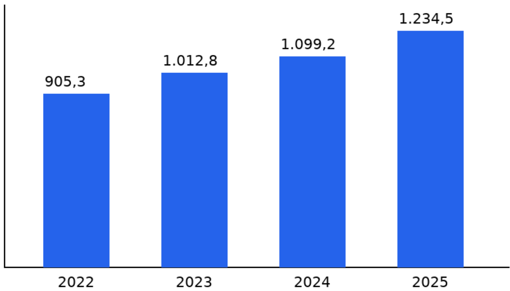

<!-- trang: 1 -->

## Phụ lục: hình ảnh và biểu đồ

*Doanh thu thuần (tỷ đồng)*

> **[Biểu đồ · mô tả tự động]** Trend of Value Over Time — bar
> 
> The chart shows the trend of a value over four years, from 2022 to 2025. The values are 905.3 in 2022, 1,012.8 in 2023, 1,099.2 in 2024, and 1,234.5 in 2025. The values are increasing each year.
> 
> | Year | Value |
> |---|---|
> | 2022 | 905.3 |
> | 2023 | 1,012.8 |
> | 2024 | 1,099.2 |
> | 2025 | 1,234.5 |
>
> Chữ trong hình: 1.234,5 1.099,2 1.012,8 905,3 2022 2023 2024 2025

*Hình 1. Doanh thu thuần giai đoạn 2022–2025*

> **[Hình ảnh · mô tả tự động]** This image is a blurred and pixelated photo with a gradient background transitioning from green at the bottom to pink at the top. The image appears to be a digital or screen capture.

*Hình 2. Toàn cảnh nhà máy mới*
